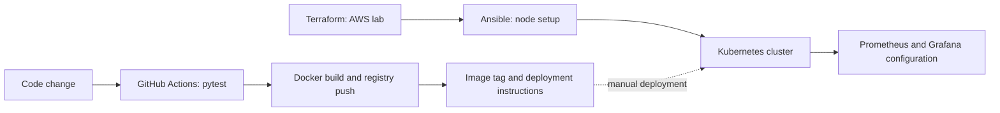

# Cloud DevOps Delivery Lab

An academic project connecting a **Flask task API, automated tests, Docker images and Kubernetes manifests**, with Terraform and Ansible for an AWS lab environment.

The repository demonstrates how application code, infrastructure and delivery configuration fit together. It is a learning environment rather than a managed production service.

## Architecture and delivery status



**Important:** the current workflow's final job prints Kubernetes deployment commands. It does not execute a cluster rollout. Rolling-update and autoscaling settings exist in the manifests; automatic deployment and zero-downtime behavior must not be inferred from a green workflow alone.

## Try the API locally first

```bash
git clone https://github.com/shirahex/devops-project.git
cd devops-project
python -m venv .venv
# macOS/Linux
source .venv/bin/activate
# Windows PowerShell: .venv\Scripts\Activate.ps1
python -m pip install -r app/requirements.txt
cd app
python -m pytest test_app.py -v
python app.py
```

API: http://localhost:5000

```bash
curl http://localhost:5000/health
curl http://localhost:5000/tasks
```

Tasks are held in memory. They reset on process restart and are not shared between Gunicorn workers. Use a shared database before treating this as a multi-worker task service.

## Run with Docker

From the repository root:

```bash
docker compose -f docker/docker-compose.yml up --build
```

The Compose build context resolves to `app/`; the Dockerfile runs the existing pytest suite during its build. Stop the local containers with `docker compose -f docker/docker-compose.yml down`.

## Repository map

| Path | What to inspect |
| --- | --- |
| [app/](app/) | Flask API, dependencies and nine pytest cases |
| [docker/](docker/) | Multi-stage image and local Compose file |
| [.github/workflows/ci-cd.yml](.github/workflows/ci-cd.yml) | Test, image build/push and deployment guidance |
| [k8s/](k8s/) | Deployment, service, probes, HPA and ingress |
| [terraform/](terraform/) | AWS resources and outputs |
| [ansible/](ansible/) | Node configuration and deployment playbooks |
| [monitoring/](monitoring/) | Prometheus/Grafana lab configuration |

## AWS and Kubernetes lab

Provisioning is optional for reviewing the application. **Terraform creates billable AWS resources.** Review the plan, variables, region, networking and access configuration before applying it to your own account.

1. Configure AWS CLI credentials locally and review `terraform/variables.tf`.
2. From `terraform/`, run `terraform init` and `terraform plan`; apply only after reviewing the resources and cost.
3. Put your lab host addresses into `ansible/inventory.ini`.
4. Run the numbered node setup playbooks in order, then `04-deploy-app.yml` with your registry image.
5. Validate pods, services, probes, ingress and metrics in the actual cluster.
6. Destroy lab resources when finished, after checking that no required workload depends on them.

The Kubernetes and monitoring files are lab examples. Review public access, credentials, persistence and network rules before use. The HPA requires resource metrics; creating its YAML alone does not provide a metrics server.

## GitHub Actions

The workflow tests changes on the configured branches and PRs. Its main-branch image build requires `DOCKERHUB_USERNAME` and `DOCKERHUB_TOKEN` repository secrets. Never put tokens or kubeconfig contents in source files.

The final job currently provides deployment guidance only. The earlier README's `KUBECONFIG` secret is not consumed by this workflow.

## API routes

`GET /` · `GET /health` · `GET /tasks` · `POST /tasks` · `PUT /tasks/<id>` · `DELETE /tasks/<id>`

A create request accepts JSON such as `{"title": "Review the deployment configuration"}`. Inspect [app.py](app/app.py) and [test_app.py](app/test_app.py) for behavior and validation.

## Next work

Persist task data, integrate an explicitly approved rollout step, add reproducible cluster verification and version the monitoring/deployment configuration. No availability or performance SLA is claimed by this repository.
